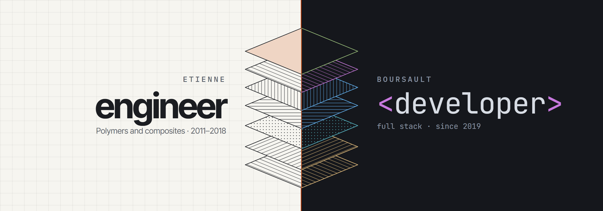

  <a href="https://etienne-boursault.github.io/CV/">
    <picture>
      <source media="(prefers-color-scheme: dark)" srcset="img/banniere-sombre.png">
      
    </picture>
  </a>

Polymer engineer from 2011 to 2018, specialised in thermoplastic injection moulding, and full stack developer since 2019. I work at [Fairphone](https://www.fairphone.com/) in Amsterdam, on the services behind its modular, repairable phones, with Kotlin, Spring Boot and Vue.js.

**[My CV](https://etienne-boursault.github.io/CV/)** · [LinkedIn](https://www.linkedin.com/in/eboursault/) · [PDF](https://etienne-boursault.github.io/CV/file/pdf/Etienne_Boursault-Resume.pdf)

### What I'm building

- **[Reco](https://github.com/Etienne-Boursault/Reco)**: an open source engine that extracts, checks and publishes the works recommended in podcasts. Public instance: [unebonnere.co](https://unebonnere.co). Python, Astro, LLMs.
- **Damier**: plan, preview and organise an Instagram feed, with a 3:4 grid, drag and drop, and one image split into tiles published in order. Web and mobile app: Next.js, Expo, TypeScript.
- **Chrono**: finds historical events, turns them into illustrated carousels and publishes them on Instagram every day, unattended. TypeScript, LLMs, Satori.
- **Income Tracker**: an Android budget app whose data never leaves the phone. Vue 3, Capacitor, SQLite. In progress.

Damier, Chrono and Income Tracker are private repositories for now.
